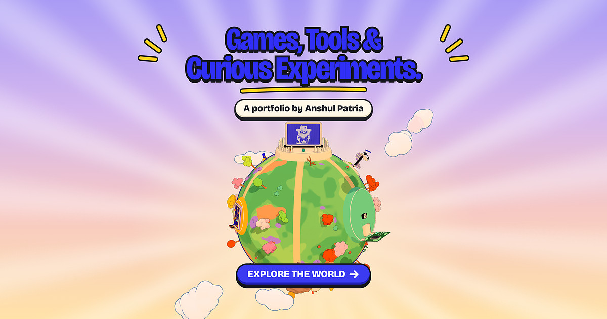

# Small Planet

**A 3D portfolio you walk around instead of scroll.**
Anshul Patria's games, tools and creative-coding experiments live on a tiny cel-shaded planet built with three.js.

**Live:** https://anshulpatria.github.io/small-planet/



---

## What it is

The landing screen shows the whole site in miniature: a hand-built planet you can drag to spin. **Enter the planet** to walk a small creature called Blip between ten projects, or **Skip the walking** to open a plain project list.

- **Cel shading.** Every surface is drawn in exactly two tones, lit and shade, with a constant-width ink outline, so it reads like a picture book rather than a game engine.
- **Locals with opinions.** Five original creatures (Zip the yak, Tall Sid, Lumen, Chomp and Gulp) each have an animated trick, a Web Audio babble voice and something to say.
- **A map you flip like a coin.** A sphere is hard to map, so each face of the coin is one hemisphere laid flat like a board game, with live miniature pieces. Tap a piece to teleport there.
- **Things to find.** Twenty butterflies, badges, three secrets, a moon you can be fired at, and rewards at the end: wallpapers and a printable 3D Blip (STL / 3MF).
- **Works everywhere.** Keyboard, mouse, touch stick and gamepad; desktop, tablet and phone. Sound starts on your first click or tap and can be muted.

## Projects on the planet

| Project | Kind | What it does |
|---|---|---|
| [Pin Art 3D](https://anshulpatria.github.io/3D-pin-art/) | Toy | A depth-driven pinscreen: push the pins or imprint a photo, relight and orbit |
| [Gravity Pong](https://anshulpatria.github.io/gravitypong/) | Game | Pong with gravity wells, power shots and magnets, 1 or 2 players |
| [Brand Studio](https://anshulpatria.github.io/brandstudio/) | Tool | Identity systems from a metaball grid, exporting stills and video |
| [Engraver](https://anshulpatria.github.io/linevisualiser/) | Tool | Redraws any image as strokes; export SVG, PNG or WebM |
| [Field](https://field-8yc.pages.dev/) | Catalogue | Twenty generative cursor effects, each with its code |
| [GenAI After Hours](https://anshulpatria.github.io/genaiafterhourspub/) | Deck | Building microsites with AI tools |
| [Orchestrator](https://youtu.be/oySlLRl5EBI) | Film | A generated film made in under sixteen hours of prompting |
| [The bracket does it again](https://youtu.be/M1nIsHUE6dg) | Film | Finding the story inside an ordinary slide deck |
| [AI Momentum to Value](https://sea-ai-maturity.bcg.com/) | Report | Interactive hexagon report on Southeast Asia's path to AI value |
| [GitHub Portfolio](https://anshulpatria.github.io/) | Site | The wider collection of tools, toys, games and decks |

## What's in this repository

| Path | Contents |
|---|---|
| `index.html` | The single page: landing screen, HUD, dock, map and project panels, plus SEO meta, Open Graph tags and JSON-LD structured data |
| `styles.css` | All styling: landing, HUD, collector's dock, coin map, panels, toasts, and phone / tablet / landscape layouts |
| `src/` | The app as plain ES modules. `main.js` boots the world; `planet.js`, `world.js`, `sky.js`, `toon.js` draw it; `player.js`, `camera.js`, `input.js` move you; `zip.js`, `sid.js`, `lumen.js`, `chomp.js`, `gulp.js` are the locals; `boardmap.js` is the coin map; `audio.js`, `sfx.js`, `radio.js` are the sound; `ui.js`, `rewards.js`, `life.js`, `savestate.js` handle panels, badges, butterflies and progress |
| `src/games/` | The playable in-world versions of Pin Art, Gravity Pong, Brand Studio and Engraver |
| `assets/models/` | glTF models: the planet, Blip, the five creatures, the moon, trees and props |
| `assets/audio/` | Ambient bed, creature voices, foley, interaction sounds and the radio, as audio sprites with JSON cue sheets |
| `assets/shots/` | Project thumbnails shown in the panels and the list |
| `assets/rewards/` | Unlockable wallpapers and the printable Blip (STL and 3MF) |
| `assets/og/` | The 1200×630 share image used for link previews |
| `assets/icons/`, `assets/cursor/`, `favicon.*` | App icons, favicons (Blip in blue and ink) and the custom cursors |
| `vendor/` | three.js r169 and three-mesh-bvh, vendored unmodified (MIT) |
| `llms.txt` | A plain-language summary of the site for AI assistants |
| `robots.txt`, `sitemap.xml` | Crawler rules and the sitemap |
| `.nojekyll` | Tells GitHub Pages to serve every file as-is |
| `LICENSE` | All rights reserved (see below) |

## Built with

three.js r169 · WebGL · custom GLSL toon and outline shaders · three-mesh-bvh · Web Audio API · Blender · vanilla JavaScript ES modules with an import map. No framework and no build step: the files here are exactly what the browser loads.

## Run it locally

```sh
python3 -m http.server 8000
```

Then open http://localhost:8000.

## Licence

Copyright (c) 2026 Anshul Patria. All rights reserved. No reuse without written permission; see `LICENSE`. Third-party libraries and sounds keep their own licences.
